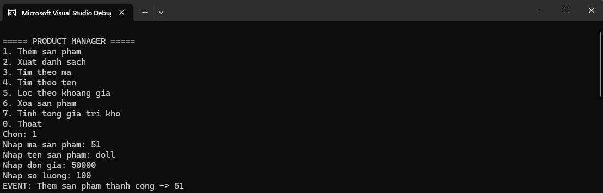
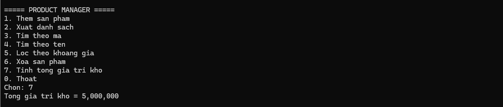
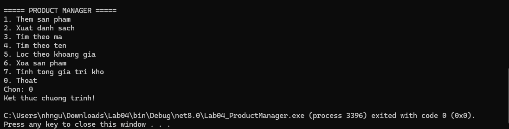

# LAB 04 - PRODUCT MANAGER

COMP1019 - Lập trình trên Windows

## Nội dung
Exception, Delegate/Event, Func/Action và Generic trong C#

## Chức năng
1. Thêm sản phẩm
2. Xuất danh sách
3. Tìm theo mã
4. Tìm theo tên
5. Lọc theo khoảng giá
6. Xóa sản phẩm
7. Tính tổng giá trị kho
0. Thoát

## Kiến thức
- try-catch và custom exception
- Event / Action
- Func<Product, bool>
- Generic Repository<T>
- Interface IEntity
- List<T>
- Lambda expression
- ProductService
## Chạy chương trình

### Thêm sản phẩm mới
hông tin sản phẩm 1

Thông tin sản phẩm 2

### Xuất danh sách

### Tìm kiếm sản phẩm theo mã

### 4.5. Chức năng 4: Tìm kiếm theo tên sản phẩm

### 4.6. Chức năng 5: Lọc theo khoảng giá

### 4.7. Chức năng 6: Xóa sản phẩm

### 4.8. Chức năng 7: Tính tổng giá trị kho hàng

### 4.9. Chức năng 0: Thoát chương trình

