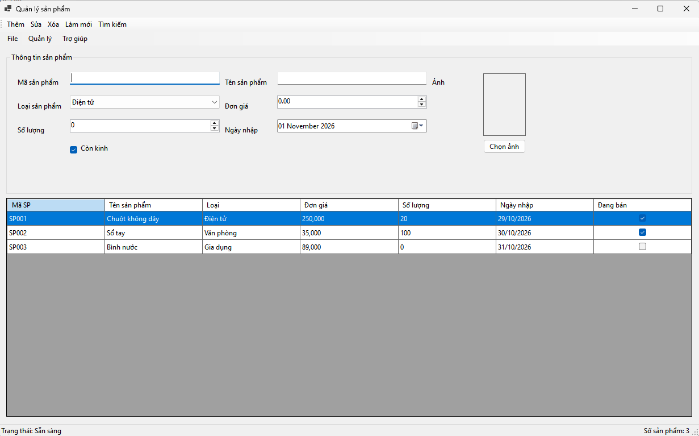
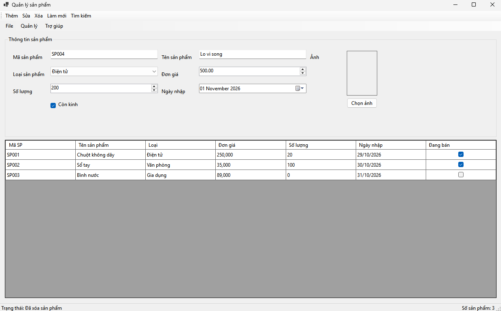
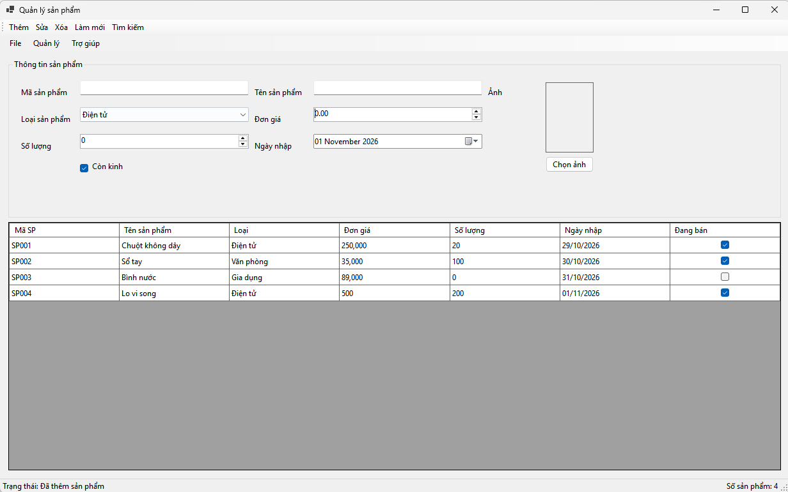
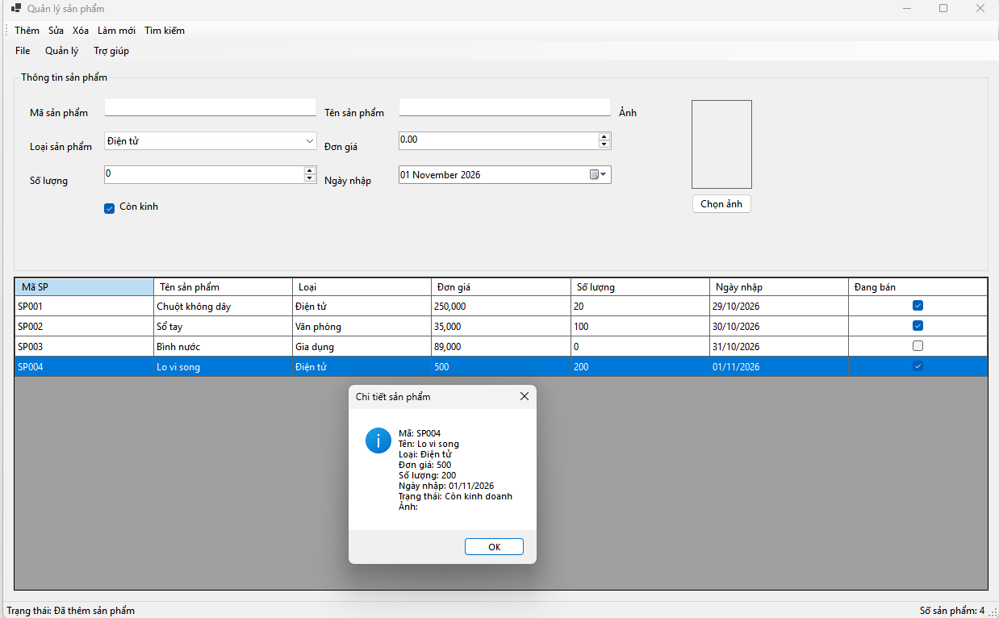
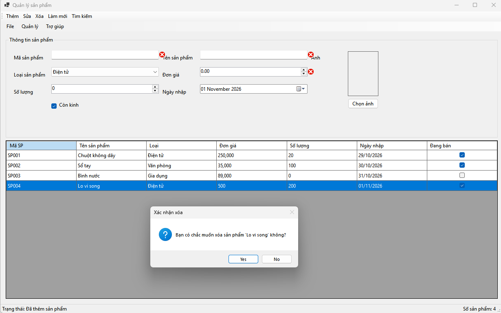
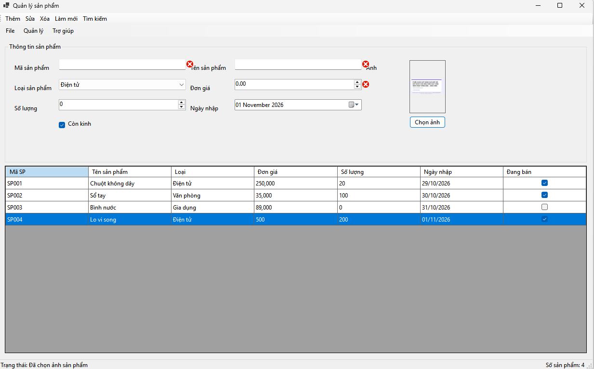

# ProductManager - COMP1019 Lab 06

## Yêu cầu
- Windows
- Visual Studio 2022 (hoặc mới hơn)
- Workload .NET desktop development
- .NET 8 SDK (hoặc đổi TargetFramework trong file `.csproj` sang phiên bản Windows .NET đang cài)

## Cách chạy
1. Giải nén thư mục `ProductManager`.
2. Mở `ProductManager.csproj` bằng Visual Studio.
3. Chờ Visual Studio tải project.
4. Nhấn `F5` để chạy.

## Chức năng
- Dữ liệu mẫu 3 sản phẩm, lưu trong bộ nhớ.
- Thêm, sửa, xóa, tìm kiếm, hiển thị tất cả/làm mới.
- Kiểm tra dữ liệu bằng ErrorProvider.
- MenuStrip, ToolStrip, StatusStrip, ContextMenuStrip.
- DataGridView, chọn ảnh bằng OpenFileDialog.
- Phím tắt: Ctrl+N thêm (mở form để nhập), Delete xóa, F5 hiển thị tất cả.

Lưu ý: dữ liệu chỉ tồn tại trong lúc chương trình đang chạy; chưa kết nối SQL Server và chưa lưu dữ liệu vào file.
## Thực nghiệm

### Khởi tạo ứng dụng

### Nhập thông tin

## Thêm sản phẩm mới

### Xem chi tiết sản phẩm

### 4.4. Xóa sản phẩm có hộp thoại xác nhận

### 4.5. Chọn hình ảnh

